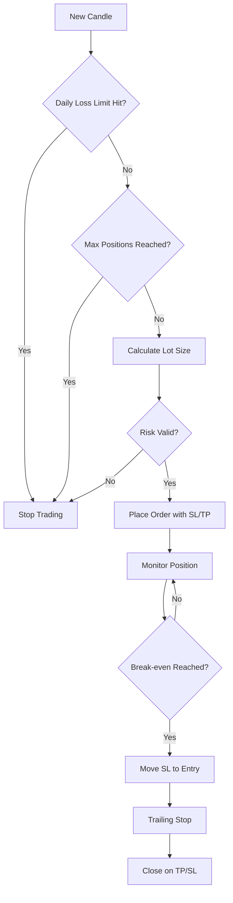
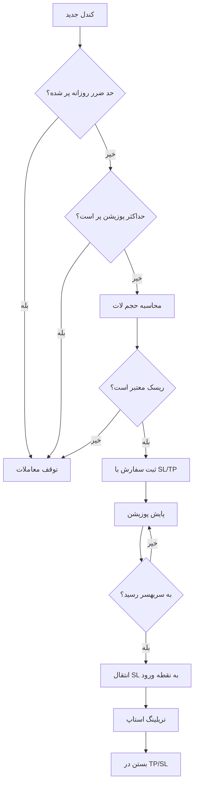

<!-- ================= HEADER ================= -->
<div align="center">

# 🧠 Panel for Meta5 — Money Management EA

**A lightweight, reliable, and safe Money Management Expert Advisor for MetaTrader 5**

[](https://github.com/pytho584)
[](https://www.metatrader5.com/)
[](https://www.mql5.com/en/docs)
[](./LICENSE)
[](https://github.com/pytho584/panel-for-meta5)
[](#-contributing)

[English](#-english) · [فارسی](#-نسخه-فارسی)

</div>

---

<!-- ================= ENGLISH ================= -->

# 🇬🇧 English

## 📖 Overview

**Panel for Meta5** is a lightweight and reliable **Money Management Expert Advisor (EA)** for **MetaTrader 5**, built with **MQL5**.

It focuses on **risk-based position sizing**, **capital protection**, and **automated trade management** — simple to use, safe to run, and easy to extend.

> ⚠️ **Note:** File extensions must be `.mq5` for MetaTrader 5.  
> (`.mq4` is for MetaTrader 4 — not compatible.)

---

## ✨ Features

| Feature | Description |
|---|---|
| 📊 **Risk-based lot sizing** | Calculates lot size from account balance & risk % |
| 🛡️ **Drawdown protection** | Stops trading when daily/overall loss limit is hit |
| 📈 **Auto SL/TP** | Sets Stop Loss and Take Profit based on ATR or fixed pips |
| 🔁 **Break-even & trailing stop** | Locks in profits automatically |
| ⚖️ **Max open positions & max lot limit** | Prevents over-leveraging |
| 🕐 **Trading session filter** | Restricts trading to specific hours |
| 📰 **News filter** *(optional)* | Avoids high-impact news events |
| 🧾 **Detailed logs & alerts** | Full transparency of every decision |

---

## 🖼️ Screenshots

> *Replace the images below with your own screenshots.*

<p align="center">
  
</p>

<p align="center">
  
</p>

---

## 📂 Project Structure

```
panel-for-meta5/
├── plan.mq5            # v1 — simple and healthy base version
├── v2-plan.mq5         # v2 — improved UI and logic
├── v3-panel.mq5        # v3 — full money management panel
├── screenshots/        # images used in README
├── docs/               # extra documentation
├── README.md
└── LICENSE
```

---

## 🧠 How It Works



**Step by step:**

1. Calculates lot size from **account balance × risk % ÷ SL distance**
2. Validates against **max lot** and **margin requirements**
3. Places order with **SL/TP** already attached
4. Monitors position for **break-even** and **trailing**
5. Blocks new trades if **daily loss limit** or **max positions** is reached
6. Logs every action for review

---

## ⚙️ Installation

1. Open **MetaTrader 5**
2. Go to **File → Open Data Folder**
3. Navigate to `MQL5/Experts/`
4. Copy the `.mq5` files into that folder
5. In MetaTrader, press **F4** to open **MetaEditor**
6. Open the file and click **Compile** (`F7`)
7. Back in MT5, drag the EA onto a chart
8. Enable **AutoTrading** and allow algorithmic trading in EA settings

---

## 🚀 Usage

| Input | Description | Default |
|---|---|---|
| `RiskPercent` | Risk per trade (% of balance) | `1.0` |
| `MaxLot` | Maximum allowed lot size | `5.0` |
| `SL_Pips` | Stop Loss in pips | `30` |
| `TP_Pips` | Take Profit in pips | `60` |
| `UseBreakEven` | Enable break-even logic | `true` |
| `TrailStop` | Trailing stop distance (pips) | `20` |
| `MaxPositions` | Max simultaneously open positions | `3` |
| `DailyLossLimit` | Daily loss limit (%) | `5.0` |
| `SessionStart` | Trading session start (server time) | `08:00` |
| `SessionEnd` | Trading session end (server time) | `20:00` |

---

## 📊 Version History

| Version | File | Changes |
|---|---|---|
| v1 | `plan.mq5` | Simple and healthy base EA |
| v2 | `v2-plan.mq5` | Improved UI and logic |
| v3 | `v3-panel.mq5` | Full money management panel |

---

## 🗺️ Roadmap

- [x] v1 — Simple base EA
- [x] v2 — Improved UI
- [x] v3 — Full money management panel
- [ ] v4 — Multi-symbol support
- [ ] v5 — Telegram notifications
- [ ] v6 — Backtest optimization presets
- [ ] v7 — Web dashboard (optional)

---

## ❓ FAQ

**Q: Does this work on MetaTrader 4?**  
A: No. This EA is written in MQL5 and only works on MetaTrader 5. For MT4, you'd need a `.mq4` version.

**Q: Can I use it on a live account immediately?**  
A: We strongly recommend testing on a **demo account** first, then a **cent account**, before going live.

**Q: How do I change the risk per trade?**  
A: Open the EA settings and adjust `RiskPercent`. Default is `1.0` (1% of balance).

**Q: Does it work on all symbols?**  
A: Currently optimized for major Forex pairs. Multi-symbol support is planned for v4.

**Q: Where are the logs?**  
A: In MetaTrader 5, go to the **Experts** tab in the Terminal window.

---

## ⚠️ Disclaimer

Trading involves risk. This EA is provided **as-is** for educational purposes.  
Always test on a **demo account** first, then on a **cent account**, before using real money.  
**Past performance does not guarantee future results.**

---

## 🤝 Contributing

Contributions, issues, and feature requests are welcome!

1. Fork the project
2. Create your branch: `git checkout -b feature/AmazingFeature`
3. Commit changes: `git commit -m 'feat: add AmazingFeature'`
4. Push: `git push origin feature/AmazingFeature`
5. Open a **Pull Request**

For major changes, please open an **issue** first.

---

## 📜 License

This project is licensed under the **MIT License** — free to use, modify, and distribute.  
See the [`LICENSE`](./LICENSE) file for details.

---

## 👤 Author

**pytho584**  
🔗 GitHub: [@pytho584](https://github.com/pytho584)  
📦 Repo: [panel-for-meta5](https://github.com/pytho584/panel-for-meta5)

---

<div align="center">

### ⭐ If this project helped you, give it a star!

</div>

---

<!-- ================= PERSIAN ================= -->

# 🇮🇷 نسخه فارسی

## 📖 معرفی

**پنل مدیریت سرمایه برای متاتریدر ۵** یک **اکسپرت مدیریت سرمایه (EA)** سبک و مطمئن است که با زبان **MQL5** نوشته شده.  
هدف آن **محاسبه حجم معامله بر اساس ریسک، کنترل ضرر و محافظت از سرمایه** است — ساده برای استفاده، امن برای اجرا و راحت برای توسعه.

> ⚠️ **نکته:** پسوند فایلها باید `.mq5` باشد (برای متاتریدر ۵).  
> پسوند `.mq4` مخصوص متاتریدر ۴ است و سازگار نیست.

---

## ✨ امکانات

| ویژگی | توضیح |
|---|---|
| 📊 **محاسبه حجم لات بر اساس ریسک** | حجم از موجودی و درصد ریسک محاسبه میشود |
| 🛡️ **محافظت از سرمایه** | توقف معاملات هنگام رسیدن به حد ضرر روزانه |
| 📈 **تنظیم خودکار SL/TP** | بر اساس ATR یا پیپ ثابت |
| 🔁 **انتقال به سربهسر و تریلینگ** | قفل کردن سود بهصورت خودکار |
| ⚖️ **محدودیت پوزیشن و لات** | جلوگیری از اهرم زیاد |
| 🕐 **فیلتر ساعات معاملاتی** | فقط در بازههای مشخص |
| 📰 **فیلتر اخبار** *(اختیاری)* | جلوگیری از ورود در اخبار مهم |
| 🧾 **لاگ و هشدار کامل** | شفافیت هر تصمیم |

---

## 🖼️ تصاویر

<p align="center">
  
</p>

---

## 📂 ساختار پروژه

```
panel-for-meta5/
├── plan.mq5            # نسخه ۱ — پایه و ساده
├── v2-plan.mq5         # نسخه ۲ — بهبود ظاهر و منطق
├── v3-panel.mq5        # نسخه ۳ — پنل کامل مدیریت سرمایه
├── screenshots/        # تصاویر README
├── docs/               # مستندات اضافه
├── README.md
└── LICENSE
```

---

## 🧠 نحوه کارکرد



**مرحلهبهمرحله:**

1. محاسبه حجم لات از **موجودی × درصد ریسک ÷ فاصله SL**
2. اعتبارسنجی با **حداکثر لات** و **مارجین**
3. ثبت سفارش با **SL/TP** از پیش تعیینشده
4. پایش پوزیشن برای **سربهسر** و **تریلینگ**
5. بلاک کردن معاملات جدید اگر **حد ضرر روزانه** یا **حداکثر پوزیشن** پر شد
6. لاگ کردن هر اقدام برای بازبینی

---

## ⚙️ نصب

1. **متاتریدر ۵** رو باز کن
2. **File → Open Data Folder**
3. برو به `MQL5/Experts/`
4. فایلهای `.mq5` رو اونجا کپی کن
5. توی متاتریدر **F4** بزن تا **MetaEditor** باز شه
6. فایل رو باز کن و **F7** بزن (Compile)
7. برگرد توی MT5 و اکسپرت رو روی چارت بکش
8. **AutoTrading** رو روشن کن

---

## 🚀 راهنمای ورودیها

| ورودی | توضیح | پیشفرض |
|---|---|---|
| `RiskPercent` | ریسک هر معامله (٪ موجودی) | `1.0` |
| `MaxLot` | حداکثر حجم مجاز | `5.0` |
| `SL_Pips` | حد ضرر به پیپ | `30` |
| `TP_Pips` | حد سود به پیپ | `60` |
| `UseBreakEven` | فعالسازی سربهسر | `true` |
| `TrailStop` | فاصله تریلینگ (پیپ) | `20` |
| `MaxPositions` | حداکثر پوزیشن باز | `3` |
| `DailyLossLimit` | حد ضرر روزانه (٪) | `5.0` |
| `SessionStart` | شروع سشن (وقت سرور) | `08:00` |
| `SessionEnd` | پایان سشن (وقت سرور) | `20:00` |

---

## 📊 تاریخچه نسخهها

| نسخه | فایل | تغییرات |
|---|---|---|
| v1 | `plan.mq5` | نسخه پایه ساده و سالم |
| v2 | `v2-plan.mq5` | بهبود ظاهر و منطق |
| v3 | `v3-panel.mq5` | پنل کامل مدیریت سرمایه |

---

## 🗺️ نقشه راه

- [x] v1 — نسخه پایه
- [x] v2 — بهبود UI
- [x] v3 — پنل کامل
- [ ] v4 — پشتیبانی چند نماد
- [ ] v5 — اعلان تلگرام
- [ ] v6 — پریستهای بهینهسازیشده
- [ ] v7 — داشبورد وب (اختیاری)

---

## ❓ سوالات متداول

**س: روی متاتریدر ۴ کار میکنه؟**  
ج: نه. این اکسپرت با MQL5 نوشته شده و فقط روی متاتریدر ۵ کار میکنه.

**س: میتونم مستقیم روی حساب واقعی استفاده کنم؟**  
ج: اکیداً توصیه میشه اول روی **حساب دمو**، بعد **حساب سنت**، و در آخر با پول واقعی تست کنی.

**س: چطور درصد ریسک رو عوض کنم؟**  
ج: توی تنظیمات اکسپرت، مقدار `RiskPercent` رو تغییر بده. پیشفرض `1.0` (یک درصد) هست.

**س: روی همه نمادها کار میکنه؟**  
ج: فعلاً برای جفتارزهای اصلی بهینه شده. پشتیبانی چند نماد برای v4 برنامهریزی شده.

**س: لاگها کجان؟**  
ج: توی متاتریدر ۵، تب **Experts** در پنجره Terminal.

---

## ⚠️ هشدار

معامله در بازارهای مالی **ریسک** دارد. این اکسپرت **همانطور که هست** برای اهداف آموزشی ارائه شده.  
اول روی **حساب دمو**، بعد روی **حساب سنت**، و در آخر با **پول واقعی** تست کن.  
**عملکرد گذشته تضمینی برای آینده نیست.**

---

## 🤝 مشارکت

از مشارکت، ایشو و پیشنهاد استقبال میکنیم!

1. پروژه رو **Fork** کن
2. برنچ بساز: `git checkout -b feature/AmazingFeature`
3. کامیت کن: `git commit -m 'feat: add AmazingFeature'`
4. پوش کن: `git push origin feature/AmazingFeature`
5. **Pull Request** بزن

برای تغییرات بزرگ، اول یه **Issue** باز کن.

---

## 📜 مجوز

این پروژه تحت مجوز **MIT** منتشر شده — آزاد برای استفاده، تغییر و توزیع.  
جزئیات در فایل [`LICENSE`](./LICENSE).

---

## 👤 نویسنده

**pytho584**  
🔗 گیتهاب: [@pytho584](https://github.com/pytho584)  
📦 ریپو: [panel-for-meta5](https://github.com/pytho584/panel-for-meta5)

---

<div align="center">

### ⭐ اگه این پروژه بهت کمک کرد، یه ستاره بده!

</div>
